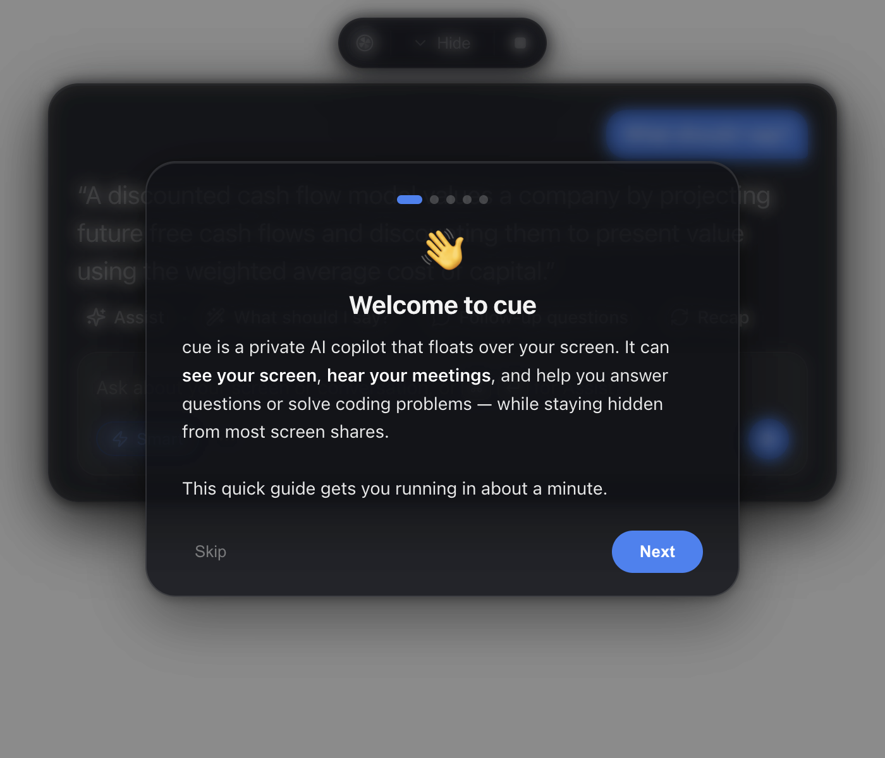
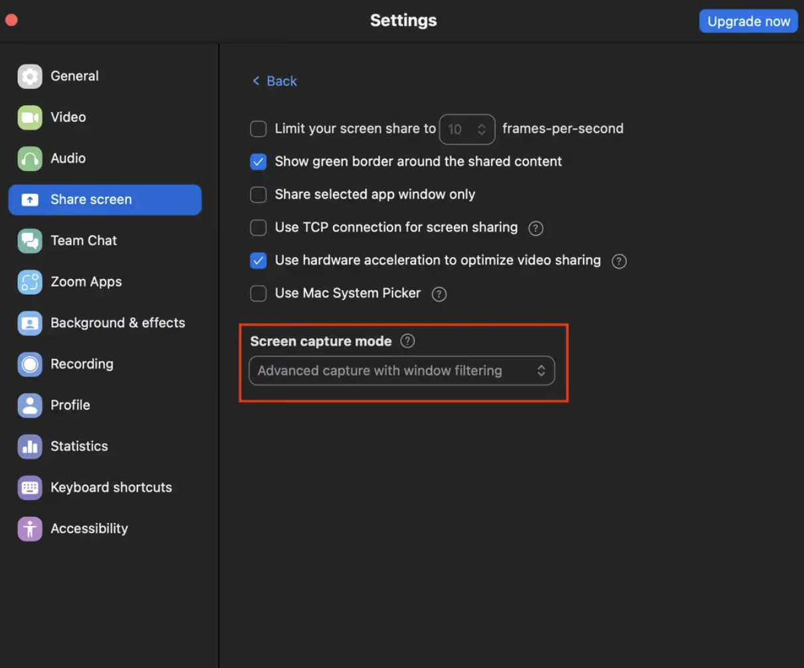

<div align="center">

# wingman

**An AI copilot that floats over your screen — sees what you see, hears your meetings, and stays hidden from screen shares.**

Bring your own AI key (OpenAI · Anthropic · Google Gemini · Nvidia · Groq).



</div>

---

> [!IMPORTANT]
> **Please read this first.** wingman tries to stay out of screen recordings/shares, but this is **best-effort, not guaranteed** — on macOS 15.4+ Apple can let modern capture tools see it anyway, and a phone camera always can. Using a hidden assistant during a **proctored exam, job interview, or recorded meeting** may break that platform's rules and, in some places, consent laws. wingman is built for legitimate uses — your own notes, studying, accessibility, and practice. **You are responsible for how you use it.**
>
> On Zoom specifically, whether wingman is hidden depends on one setting — **Settings → Share Screen → Screen capture mode → "Advanced capture with window filtering."**
>
> 

---

## What it does

wingman floats a small glass panel on top of everything. It takes **three separate inputs** — your **screen**, your **microphone**, and your **meeting audio** (what the other person says) — and uses an AI model to help you in real time.

| Feature | How to trigger | What it uses |
|---|---|---|
| **Assist** | `⌘` `↵` by default (configurable) or the *Assist* button | your screen + recent conversation |
| **What should I say?** | button | meeting audio + your mic |
| **Follow-up questions** | button | the whole conversation |
| **Recap** | button | the whole conversation |
| **Ask anything** | type + `↵` | your screen + conversation |
| **Solve a coding problem** | `⌘` `H` | your screen only |
| **Smart** toggle | pill in the box | switches to a smarter (slower) model |

It's a copilot for **live meetings** ("what do I say to that?") and **coding problems** (screenshot → full solution), and it's designed to be **invisible in screen shares** so it stays your private assistant.

---

## Install and run

You need [Node.js](https://nodejs.org) 18+ installed. No Xcode required.

```bash
npm install
npm start
```

To build a standalone app:
```bash
npm run pack      # creates dist/mac-arm64/wingman.app
```

> Note: the packaged app is **ad-hoc signed** (no paid Apple certificate). macOS ties permission grants to the exact build, so **rebuilding resets the mic/screen permissions** — you'll grant them again. For everyday use, build once and keep it.

---

## First launch — the 1-minute setup

When wingman opens the first time, a **built-in tutorial** walks you through everything below. You can reopen it anytime by clicking the **wingman logo** (top-left of the pill).

### Step 1 — Grant two macOS permissions

wingman can't help until macOS lets it see and hear. When you first use a feature, macOS will prompt you — click **Allow**. If a prompt doesn't appear, add wingman manually:

- **Microphone:** System Settings → **Privacy & Security** → **Microphone** → turn on **wingman**.
- **Screen Recording:** System Settings → **Privacy & Security** → **Screen Recording** → turn on **wingman**. (This one grant covers both screenshots *and* meeting audio.) macOS may ask you to **quit & reopen** wingman — let it.

### Step 2 — Add your AI key (bring your own)

wingman uses **your own** API key, so it's free to run (you only pay your AI provider for what you use). Click the **`...`** button in the input box (or press `⌘` `,`) to open **Settings**, pick a provider, and paste your key:

| Provider | Get a key | Notes |
|---|---|---|
| **OpenAI** | [platform.openai.com/api-keys](https://platform.openai.com/api-keys) | One key does everything — **but** for the *listening* features the key must have **Whisper / audio** access. |
| **Anthropic (Claude)** | [console.anthropic.com](https://console.anthropic.com) | Great for screen & coding help. Add an OpenAI or Gemini key for listening. |
| **Google Gemini** | [aistudio.google.com/apikey](https://aistudio.google.com/apikey) | One key does chat + transcription. |
| **Nvidia** | [build.nvidia.com](https://build.nvidia.com) | Free credits for fast, vision-capable Llama models. |
| **Groq** | [console.groq.com](https://console.groq.com) | Extremely fast Llama models, chat + vision. |

Your key is stored **only on your computer** (in `wingman-data.json`) and is sent **only** to that provider. wingman has no server and collects nothing.

### Step 3 — The Zoom setting (only needed for Zoom)

wingman is hidden from most screen-share tools automatically — **Google Meet, Microsoft Teams, and QuickTime need nothing.** **Zoom** has a specific setting that decides whether it respects wingman's "don't capture me" flag:

> **Zoom → Settings → Share Screen → Advanced → Screen capture mode → choose "Advanced capture with window filtering."**

<div align="center"></div>

---

## How to use

- **`⌘` `↵` — Assist.** The do-the-smart-thing key. On a coding problem it solves it; in a conversation it tells you what to say. Works from anywhere. Change this shortcut under **Settings → Keyboard shortcuts**.
- **`⌘` `H` — Solve what's on screen.** Screenshots a coding problem and returns the approach, code, and complexity.
- **The `▢` button** (top bar) — start/stop **listening** to a meeting. The green dot means it's live.
- **Type a question** in the box and press `↵` to ask about your screen or conversation.
- **Smart** — flip it on for a smarter, more thorough model; off for fast and cheap.
- **Hide** collapses the panel to just the top bar. Drag wingman around by the **top pill**. Quit with `⌘` `⇧` `X`.

The panel is see-through and click-through — the empty space around it never blocks the app behind it.

---

## How it works

wingman is an [Electron](https://www.electronjs.org/) app. Everything runs locally except the calls to your chosen AI provider.

**The three inputs are kept completely separate:**
- **Screen** — captured with Electron's `desktopCapturer` (full-resolution screenshots, taken only when a feature needs one).
- **Your mic ("You")** — `getUserMedia` → downsampled to 16 kHz audio → transcribed.
- **Meeting audio ("Them")** — `getDisplayMedia` loopback capture of your system's output audio, kept on its own channel so wingman knows *who* said what.

Both audio streams are transcribed (Whisper or Gemini) and fed, with an optional screenshot, to your AI model. Responses **stream** into the panel word-by-word.

**The invisibility** is a single macOS window flag: `setContentProtection(true)`, which sets `NSWindowSharingNone`. This asks the window server to exclude wingman from screen-capture streams. It's the same mechanism DRM apps and Zoom's own toolbar use. It is **not** a GPU trick or a special overlay layer — and on macOS 15.4+ Apple lets some capture tools ignore it, which is why it's best-effort (see the disclaimer at the top).

```
main process ──┬─ overlay window (frameless, transparent, always-on-top, content-protected)
               ├─ screenshot capture (desktopCapturer)
               ├─ speech-to-text (Whisper / Gemini)      ── "You" + "Them" channels
               └─ LLM streaming (OpenAI / Anthropic / Gemini / Nvidia / Groq)
renderer ──────┴ the glass UI + mic capture + system-audio loopback
```

---

## Troubleshooting

**"It says give access, but I already gave access."**
You probably granted an older build. Because the app is ad-hoc signed, a rebuild changes its identity and macOS stops honoring the old grant (the checkmark can linger). Toggle wingman **off and on** in System Settings → Screen Recording, or remove and re-add it.

**A feature returns "403" / "no access to model."**
- Your API key is restricted. Fix: enable the model you need on your key, or bring a different key.

**Listening does nothing / no transcript.**
- Check you need a transcription-capable key (OpenAI with Whisper, or Gemini). Also make sure Screen Recording is granted (meeting audio needs it).

**wingman shows up in my Zoom share.**
- Set Zoom's **Screen capture mode** to *"Advanced capture with window filtering"* (see Step 3).

---

## Privacy

- No accounts, no servers, no telemetry. wingman collects nothing.
- Your API keys live in a local file (`wingman-data.json`) and are sent only to the provider you chose.
- Screenshots and audio are sent to your AI provider only when a feature runs, and are not stored by wingman beyond the current session's transcript (kept in memory).

## Contributing

Issues and PRs welcome. wingman is intentionally small and readable — `main.js` (app + capture + AI), `renderer/` (the UI), `src/` (providers). No build step for the source (plain HTML/CSS/JS).

### Platform Support
- [x] **macOS** (Fully Supported)
- [x] **Windows** (Fully Supported)
- [ ] **Linux** (Untested)

### Ideas for Contribution
- [ ] Upgrade audio capture pipeline for zero-latency streaming
- [ ] Add optional Deepgram support for ultrafast transcription
- [ ] Improve the rendering pipeline for faster token updates
- [ ] Add more provider support and model selectors

## License

[GPL-3.0-or-later](LICENSE).